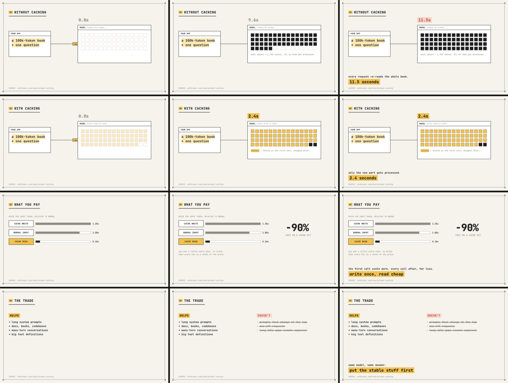

# visual-explainers

Four ways to explain something visually, from one animated screen to a full-length video.

| Skill | Output | Use it for |
|---|---|---|
| `animated-explainer` | one self-contained HTML page | One idea (a flow, an algorithm, a plan) told through a stepped, animated diagram the reader drives. Captions only, no prose. |
| `interactive-html-report` | a `site/` folder, works from `file://` | Turning a folder of markdown, a long report or session findings into a navigable page: sidebar, search, glossary, clickable diagrams. Verified in a real browser before delivery. |
| `tldr-video` | a ~45-second silent MP4 | Distilling a link, paper, thread or video into 3–5 animated scenes with a punchline each, for social feeds. |
| `whiteboard-video` | an MP4 plus an interactive viewer | Turning a YouTube talk into hand-drawn diagrams that build in sync with the speech, with the original footage picture-in-picture. |



*`tldr-video`'s bundled example, rendered as a contact sheet (each row is a scene at 30%, 62% and its final state).*

## Requirements

- `animated-explainer`, `interactive-html-report`: none beyond a browser. Browser verification uses a browser automation tool if one is available.
- `tldr-video`: `node`, `ffmpeg` and Google Chrome. Run `npm install` once in the skill's directory (the skill tells Claude to do this).
- `whiteboard-video`: `yt-dlp`, `ffmpeg`, `node` and Google Chrome; a long talk needs about 1 GB of free disk. Only use it on videos you have the right to rework.

Chrome is expected at the macOS path; set `CHROME_PATH` elsewhere.

## Install

```
/plugin marketplace add thekindofme/claude-plugins
/plugin install visual-explainers@thekindofme-plugins
```
